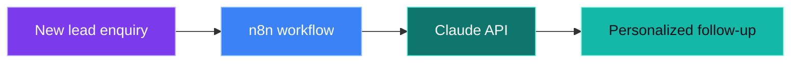

<div align="center">


<a href="https://github.com/stopit-master">
  
</a>

<br />

<a href="https://github.com/stopit-master"></a>


</div>


<div align="center">

## WHO AM I

</div>

```yaml
name: Tarun Singh
located_in: Punjab, India
education: B.Tech CSE (Core), Chandigarh University
building: Axeno - AI automation agency
focus: [AI automation, AI agents, AI agency]
currently_learning: [agentic systems, n8n, Claude API]
```


<div align="center">

## WHAT I'M BUILDING

</div>

<table width="100%">
<tr>
<td width="50%" valign="top">

### Axeno
An AI automation agency. The first product is a lead follow-up bot built with **n8n** and the **Claude API**, starting with real estate agents.

**Stack:** `n8n` `Claude API` `Next.js` `Supabase` `Vercel`

</td>
<td width="50%" valign="top">

### Rydexa
An AI-powered bike-sharing demand prediction platform.

[](https://github.com/stopit-master/rydexa)

</td>
</tr>
</table>

<br />

<div align="center">

### How the Axeno lead follow-up bot works

</div>




<div align="center">

## TECH STACK


<br /><br />


<br /><br />

### Languages


</div>


<div align="center">

## CONTRIBUTION TRAIL


</div>


<div align="center">

## CONNECT

<a href="https://github.com/stopit-master"></a>

<br />


</div>
