 

 

## ABOUT

I'm Tarun, a B.Tech CSE student at Chandigarh University, based in Punjab, India. I'm **building a business** around AI: automations and agents that take repetitive work off a team's plate.

 

## WHAT I'M BUILDING

<table width="100%">
<tr>
<td width="50%" valign="top">

### Axeno
An AI automation agency building automations and AI agents for businesses.

**Stack:** `n8n` `Claude API`

</td>
<td width="50%" valign="top">

### Rydexa
An AI-powered bike-sharing demand prediction platform.

</td>
</tr>
</table>

 

  

### Languages

 

## CONTRIBUTION TRAIL

 

